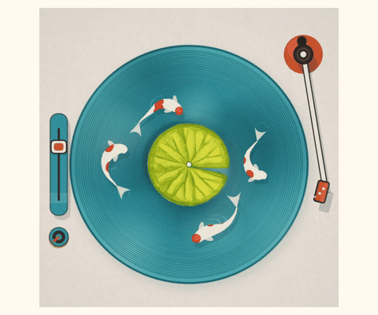
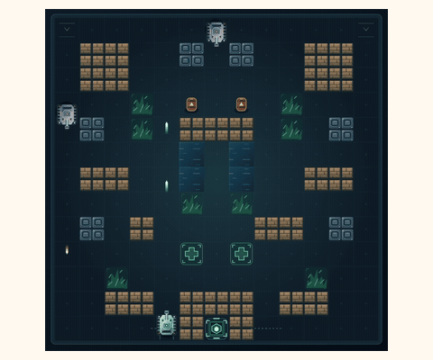
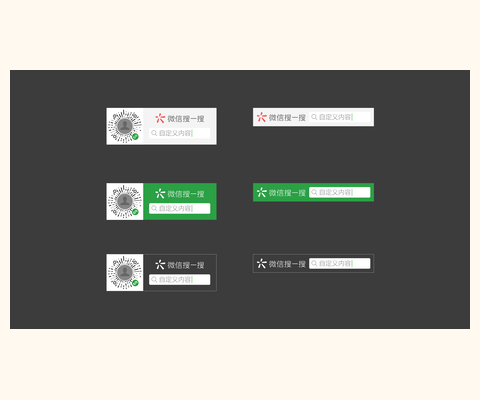

# 兔子阅读器

**收到文件，也读到内容。** 在微信里打开 HTML、Markdown、SVG、设计稿和压缩包，直接查看文件里的正文、画面与交互。


[观看 20 秒介绍视频](https://siliconyahaha.github.io/agent-rabbit-reader-dsh/) · [支持格式与限制](docs/formats.md) · [实际效果](#看看实际效果) · [本地开发](docs/development.md)

## 它能帮你做什么

- **读 AI 生成的网页**：打开 HTML 报告、交互图表或小工具，也可以直接粘贴 HTML 源码。
- **看文档和设计稿**：阅读 PDF、Markdown、Office 内容，预览 Ai、PSD 和部分设计文件。
- **打开压缩包里的文件**：浏览 ZIP、RAR、7z、TAR 目录，继续打开包内支持的文件。
- **连续看一批文件**：一次选择多个文件，在阅读页切换、返回和恢复最近阅读。
- **把文件留在本机**：选中的文件在设备本地处理，不上传到开发者服务器；HTML 交互在受限沙盒中运行。

## 如何使用

1. 在微信搜一搜中搜索 **「兔子阅读器」小程序**。
2. 点击 **「打开文件」**，从聊天记录中选择文件；或点击 **「粘贴 HTML」** 输入完整网页源码。
3. 直接阅读内容。想先体验，可从首页 **「支持格式」** 进入内置示例。

本仓库包含小程序源码和可复用的文件阅读模块。仓库代码与线上小程序的发布时间可能不同。

## 看看实际效果

点击预览可放大；下列操作特点对应小程序内的体验，首页动图用于展示。

| 案例 | 展示 | 特点 |
| --- | --- | --- |
| **锦鲤唱片机**<br>HTML | <a href="docs/images/cases/koi.gif"></a> | 添锦鲤<br>拨唱针 |
| **坦克大战**<br>HTML | <a href="docs/images/cases/tank.gif"></a> | 移动<br>开火<br>暂停 |
| **秦始皇骑车**<br>SVG | <a href="docs/images/cases/bicycle.svg"></a> | 矢量图<br>可暂停 |
| **搜一搜设计稿**<br>Ai | <a href="docs/images/cases/search-ai.png"></a> | 配色<br>版式 |
| **彩色海报**<br>PSD | <a href="docs/images/cases/psd-poster.png"></a> | 看海报<br>看全图 |
| **周末计划**<br>Markdown | <a href="docs/images/cases/markdown.png"></a> | 标题<br>表格<br>清单 |

锦鲤、坦克和骑车案例可在小程序「支持格式」中体验。锦鲤、坦克动图与 Markdown 画面来自上方演示视频，骑车保留原始 SVG 动画。PSD 为小程序内的 Mozilla 吉祥物发布海报示例；Ai 使用「搜一搜小程序物料源文件.ai」，图中的码为素材占位码。复杂效果可能存在兼容差异，详见 [格式说明](docs/formats.md)。

## 常用格式

| 文件类型 | 可以看到什么 |
| --- | --- |
| HTML、Markdown、SVG | 网页正文、排版笔记、矢量图与已支持的动画和交互 |
| PDF、Word、Excel、PowerPoint | 当前阅读页中的 PDF 页面、文档正文、工作表或幻灯片内容 |
| Ai / EPS、PSD / PSB | 文件中可解析的矢量、内嵌 PDF、合成画面或保存的预览 |
| Figma、Sketch | 文件内保存的缩略图或预览图，不是完整设计编辑器 |
| ZIP、RAR、7z、TAR | 压缩目录与可解压条目，部分加密和分卷文件可输入密码后读取 |
| JSON、CSV、BASE、文本和源码 | 缩进视图、只读表格、快照记录或原文 |
| 图片、音视频 | 图片及设备支持的媒体播放 |
| DXF、STEP、CDR | 已支持的图元、模型或内嵌预览 |

不同格式、版本和设备的能力有差异：Office 不保证桌面软件的精确排版，设计稿不支持完整图层编辑，DWG 暂不支持图纸正文。完整范围见 [格式说明](docs/formats.md)。

## 本地运行

需要 **Node.js 24、npm 和微信开发者工具**。

```sh
npm ci
npm run check
npm run check:production
```

在微信开发者工具中导入仓库根目录，源码目录为 `miniprogram/`。使用自己的小程序账号时，配置自己的 AppID；生产校验中的 AppID 约定也需同步调整。不要提交密钥和 `project.private.config.json`。

## 项目结构

| 目录 | 内容 |
| --- | --- |
| `miniprogram/` | 小程序页面、示例与本地资源 |
| `miniprogram/file-reader/` | 文件识别、解析、排版、解压与交互；`skin/` 为宿主皮肤 |
| `tests/`、`scripts/` | 回归样本、资源构建与验证工具 |
| `docs/` | 使用说明、开发指南和展示素材 |
| `compatibility/` | 兼容性档案与参考证据 |

开发细节见 [开发指南](docs/development.md) 和 [阅读模块](miniprogram/file-reader/README.md)。

## 许可

项目代码采用 [ISC](LICENSE) 许可证。第三方依赖和示例素材保留各自的许可证、来源与署名，详见 [素材来源](scripts/assets/example-art/README.md) 和 [兼容样本说明](compatibility/NOTICE.md)。
