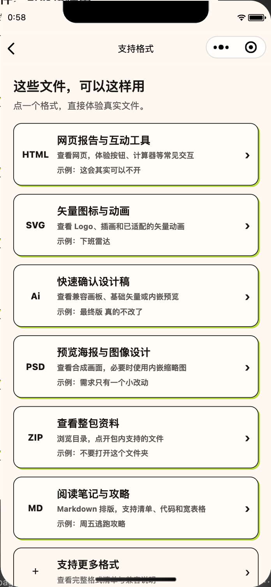
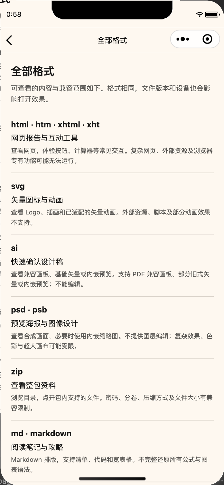

# 支持格式

首页原“打开示例”入口改为“支持格式”。用户进入后直接点格式卡片打开真实文件；没有先弹介绍、再点一次体验的中间步骤。返回仍回到卡片页。

| 首页入口 | 支持格式页 |
|---|---|
|  |  |

图片为当前代码在微信开发者工具中的本地渲染，不是真机演示或概念图。

## 展示规则

- 六张可点击卡片：HTML 网页报告与互动工具、SVG 矢量图标与动画、Ai 设计稿、PSD 海报、ZIP 资料包、Markdown 笔记与攻略。
- 先写日常用途，再写可体验的能力；保留原有趣味示例，卡片内明确标注示例名称。
- 六张卡片后最后一条为“支持更多格式”，跳转独立“全部格式”页，统一展示示例格式和其余格式的范围与兼容说明。
- 全部格式页是说明清单，没有把 ZIP 当成 RAR/7z 示例，也不将 PSD 示例等同所有 PSB 文件验证。DWG 仅列信息识别和内嵌缩略图，明确不能查看图纸正文。
- 格式清单覆盖代码登记的 54 个后缀且无重复。后缀计数不用于宣传“54 种都完整支持”。

## 验证

- 24 项相关回归通过：示例文件、首页入口和分享路由。
- 开发者工具中从首页按钮进入并逐张打开六种实际文件；HTML 按钮改变内容、SVG 暂停/继续、Ai/PSD 输出预览、ZIP 打开成员、Markdown 表格横向移动，以及返回卡片页均通过。
- 追加入口精简后，首页及分享 17 项检查通过；开发者工具实际点击“支持更多格式”后进入全部清单，核对14组预览范围及DWG信息说明合计54个后缀，并返回六张卡片页。新页面朋友圈入口仍回到首页。
- 生产配置与差异检查通过；未运行未修改功能的全量测试。

完整清单页示意：

